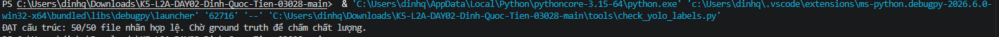
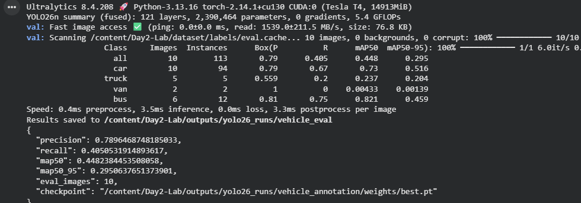

# Báo cáo cá nhân — Ngày 2 Object Detection

Đổi tên file theo `MSSV_HoTen.md`, ví dụ `20241234_NguyenVanAn.md`. Điền kết quả thật, xóa dòng hướng dẫn khi nộp. Xem [quy định nộp](../../SUBMISSION.md).

## 1. Thông tin học viên

- Họ tên:Đinh Quốc Tiến
- MSSV:2A202603028
- Email:26ai.tiendq@vinuni.edu.vn
- Lớp:L2A
- Link repo bài làm:https://github.com/NEITP/K5-L2A-DAY02-Dinh-Quoc-Tien-03028-ObjectDetection?utm_source=chatgpt.com
- Link Colab đã chạy:https://colab.research.google.com/drive/1p3Jh1d2hQRK6JOgNf5jh0ubHY-DdXoZ6?hl=vi#scrollTo=8jBrfWrj93LG

## 2. Schema và mini guideline

https://github.com/NEITP/K5-L2A-DAY02-Dinh-Quoc-Tien-03028-ObjectDetection/blob/main/GUIDELINE_MINI.md

## 3. Annotation và self-QC

- Số file nhãn train:50
- Kết quả checker và lỗi đã xử lý:

- Danh sách ít nhất 10 ảnh đã rà bằng mắt:
drive_001
drive_002
drive_003
drive_004
drive_005
drive_006
drive_007
drive_008
drive_009
drive_010
- Lỗi bỏ sót/box/class phát hiện khi rà và cách sửa:
Bỏ xót một xe ở ảnh số 4 so với gold file

## 4. Gold QC và rework

| Chỉ số | Trước sửa | Sau sửa nếu có |
|---|---:|---:|
| TP | 496 | |
| FP | 553 | |
| FN | 157 | |
| Precision | 0.4728 | |
| Recall | 0.7596 | |
| F1 | 0.5828| |
| mean_iou_of_matches | 0.8043 | |
| passed | Passed | |

https://github.com/NEITP/K5-L2A-DAY02-Dinh-Quoc-Tien-03028-ObjectDetection/blob/main/outputs/annotation_evaluation.json
Không có rework
## 5. Kết quả YOLO

- Runtime, GPU/CPU, phiên bản Ultralytics và Torch:
Runtime: Google Colab.
GPU: NVIDIA Tesla T4 14.9 GB
Python: 3.13.16
Ultralytics: 8.4.208
Torch: 2.14.1+cu130
Checkpoint: yolo26n.pt
Số epoch: 50
Best checkpoint: https://github.com/NEITP/K5-L2A-DAY02-Dinh-Quoc-Tien-03028-ObjectDetection/blob/main/report/individual/assets/yolo26_runs/vehicle_annotation/weights/best.pt

| Chỉ số trên 10 ảnh eval | Giá trị |
|---|---:|
| Precision | 0.790 |
| Recall | 0.405 |
| mAP50 | 0.448 |
| mAP50–95 | 0.295 |

Đặt cả 2 folder `assets/eval_predictions/` và `assets/yolo26_runs/` (giải nén từ `day2_colab_outputs.zip`) cạnh báo cáo và dẫn link tương đối. Không chỉ ghi số; chỉ ra ít nhất một ảnh và vật thể cụ thể.

Trả lời bốn câu hỏi cuối notebook:

1. Lớp có recall thấp nhất: van, recall = 0.000

2. Khi mAP50 cao nhưng mAP50–95 thấp, cần kiểm tra độ chính xác vị trí và kích thước bounding box ở các ngưỡng IoU nghiêm ngặt hơn
3. Cần kiểm tra khả năng nhầm lẫn giữa bus và van, đối chiếu confusion matrix, nhãn ground truth và ảnh dự đoán
4. Không dùng 10 ảnh eval để train nhằm tránh rò rỉ dữ liệu. Trong notebook, tập eval được dùng làm validation để đánh giá và lựa chọn checkpoint; vì vậy không nên xem đây là một tập test độc lập hoàn toàn

## 6. Khó khăn và cách xử lý

| Bước/thời điểm | Lỗi quan sát | Cách đã thử | Kết quả/còn thiếu |
|---|---|---|---|
| Khởi chạy Colab | Môi trường GPU | Đợi cho ggcolab hết lỗi | Đã chạy trên GPU-T4 |

## 7. Tự đánh giá theo rubric

Tiêu chí|	Kết quả bài làm	|Điểm|
|---|---|---|---|
| Hoàn thành và định dạng YOLO	|50 file cùng basename, 5 cột, normalized, bốn class ID đúng	|Done |
| Đầy đủ vật thể	|gán đủ xe thuộc schema, kể cả xe che/cắt khung có thể nhận diện	|Done |
| Độ bám sát và hình học box	|box sát phần vật thể nhìn thấy, không lấn nền/gộp vật thể	|Done |
| Phân lớp nhất quán	|phân biệt car/truck/bus/van, không gán vật thể ngoài scope	|Done |
| Mini guideline và quyết định mơ hồ	|định nghĩa lớp, quy tắc box, ít nhất ba case có lý do	|Done |
| Gold-set annotation QC	|F1 >= 0.80 và mean IoU >= 0.70 hoặc có vòng rework được giải thích rõ	|Done |
| Pipeline YOLO và phân tích	|Colab chạy được, không dùng eval để train, có metrics/ảnh eval và nhận xét lỗi	|Done |

